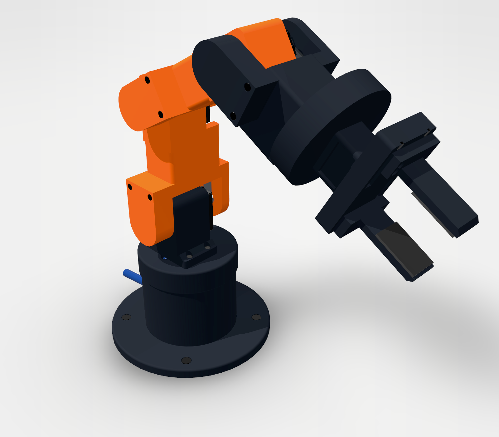
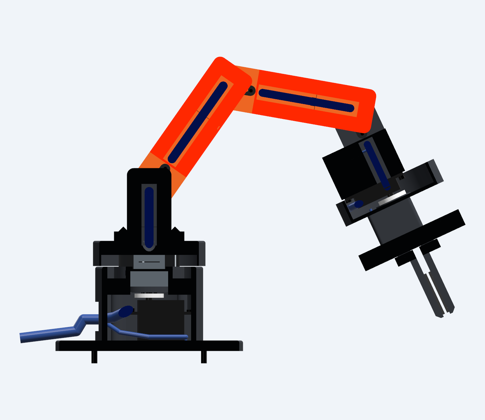
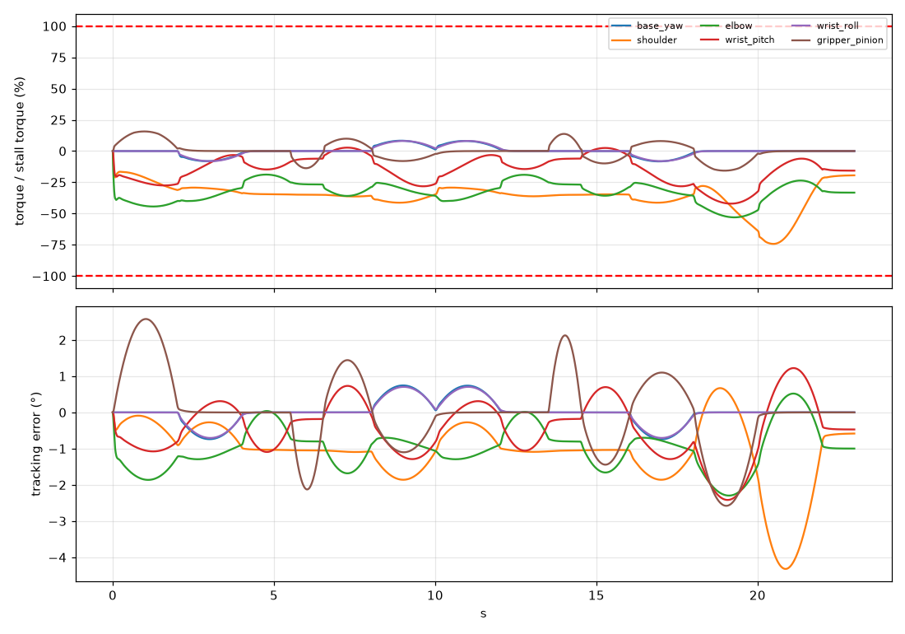
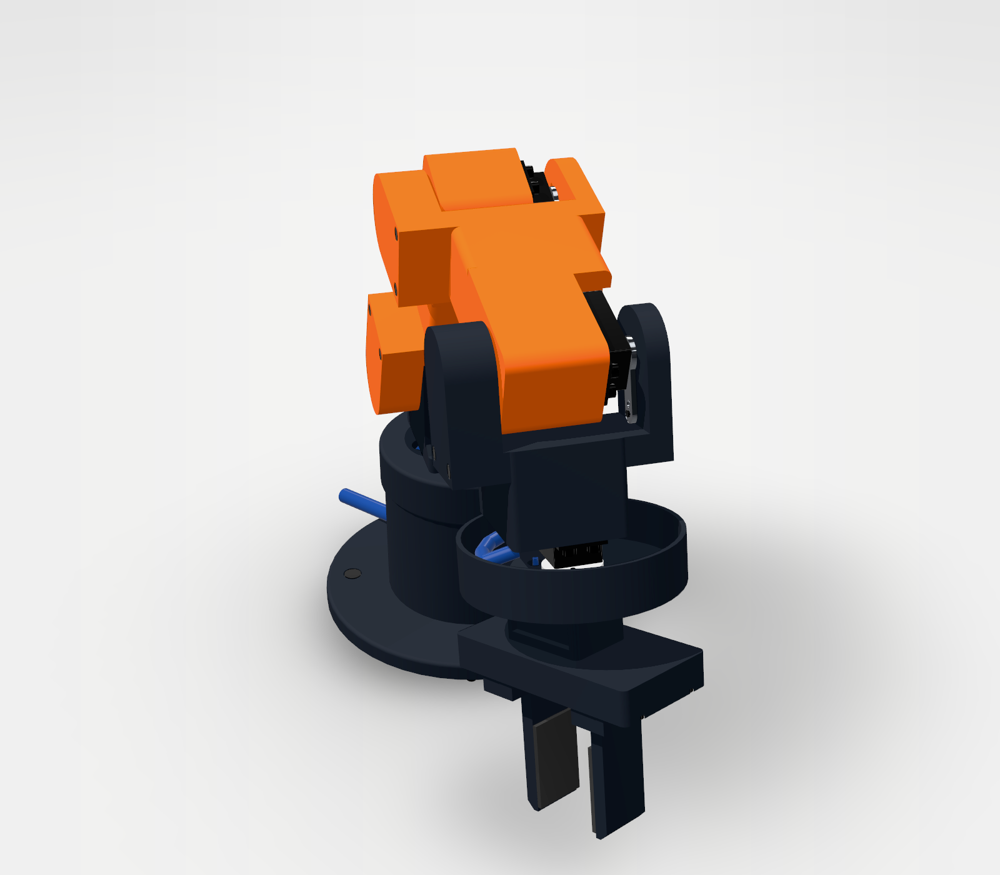
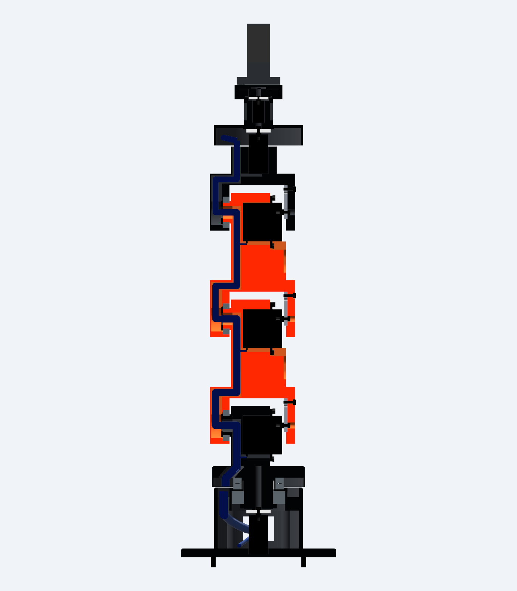
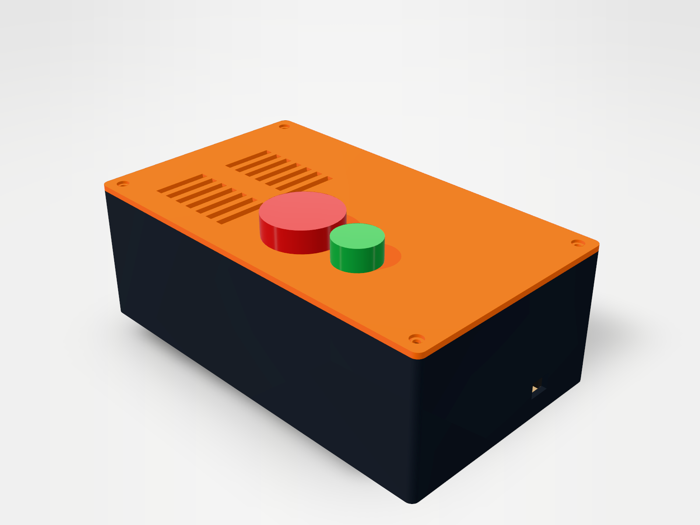

# TwinArm-5: desktop robot arm with a digital twin

Graduation project: a 5-axis robot arm with a 3D-printed body and a parallel gripper, together
with its digital twin. The twin shows the real arm's joint angles (from the servo potentiometers),
load (from the servo currents) and temperature in real time. When the arm is not connected, the
same model can be driven in MuJoCo.

Project brochure: [TwinArm5_Brochure.pdf](TwinArm5_Brochure.pdf)



The design went through four independent "red team" reviews: mechanics/assembly,
kinematics/gripper, electronics, and bill of materials/printing. The 16 blockers and more than 30
major issues found were fixed. After the revision, the design was checked with physics simulation
(MuJoCo), strength analysis (CalculiX FEA), printability checks and collision checks (see below).

**All cables run inside the arm.** The only visible cable is the main harness that runs from the
back of the base to the control box. At the pitch joints the harness passes through a hollow shaft
(6804 bearing, Ø13 bore). At the base and wrist rotations it coils like a clock spring inside a
closed cable chamber.



## Specifications

| | |
|---|---|
| Degrees of freedom | 5 axes + parallel gripper (6 servos) |
| Reach | ~400 mm from the shoulder axis to the tool tip (upper arm 110, forearm 110, wrist+gripper 178 mm) |
| Picking from the table | 60 mm vertical approach with the gripper tilted 10–15°, in the x ≈ 150–200 mm zone |
| Payload | 250 g (grasp + lift verified in simulation). 150 g for continuous operation. |
| Gripper | MG90S + module 1.5 involute rack and pinion, opening 2–46 mm, ~9 N per finger |
| Joint range | base ±90°, shoulder −70/+110°, elbow −60/+110°, wrist pitch −60/+100°, wrist roll ±90° |
| Arm mass | 1.53 kg including base, moving part 0.96 kg (URDF/MJCF, prints at 50% effective infill, cable harness included) |
| Cabling | fully through internal channels; hollow shafts (6804) and closed cable chambers at the joints |
| Feedback | position (potentiometer, differential ADS1115), current (INA226), temperature (DS18B20) |
| Controller | ESP32-S3 Super Mini, 100 Hz over USB to the twin on the PC |
| Power | 12 V 10 A → 2× XL4016 (6.0 V), relay-based emergency stop + START |

## Validation results

### Physics simulation (MuJoCo, `cad/checks/sim_dynamics.py`)

Each servo was modeled in the simulation as follows:
- **Torque limit:** stall torque (6 V).
- **Motor back-EMF damping:** stall torque / no-load speed.
- **Additional effects:** gear friction, reflected rotor inertia, PD controller.
- **Contact:** rubber pads, object and table with friction.

| Scenario | Result |
|---|---|
| `demo` motion (pick → carry → place → reach), 150 g payload | **PASS.** No servo saturation (highest: shoulder 74%), tracking error ≤ 4.3°, no self-contact or table contact |
| Grasp a 30×30×60 mm box from the table and lift it 60 mm | **PASS** (100 / 150 / 250 g). Lift 53–55 mm, slip ≤ 2.9 mm. Grasp with 1 mm squeeze gives ~4 N per finger; 0.6–1.5 N is needed |
| Holding at full horizontal reach (worst case) | 0 g: shoulder 44%. 150 g: 66%. 250 g: 81%. Tip sag 13–27 mm |
| 30 minutes of continuous `demo` loop (heat) | shoulder **65 °C** (at the limit), elbow 57 °C. With a 50% run/rest ratio the shoulder stays at ~46 °C |
| Continuous holding with 150 g, arm horizontal | shoulder reaches 65 °C in ~4 minutes. **Keep it short.** The twin's thermal warning will flag this case. |
| Power rails (`demo`) | rail 1 peak 3.1 A, rail 2 peak 1.8 A. Peak 2.7 A at the 12 V input |

The internal cabling (6804 bearings, thicker cable covers, the harness itself) made the arm
~270 g heavier; the values above were computed with this weight. A continuous demo loop now brings
the shoulder to its thermal limit, so rest periods should be added to the loop; the twin warns
about this in advance using its thermal model.



### Strength (FEA, CalculiX, `cad/checks/fea_run.py`)

Values used for the analysis:
- **Material:** PETG FDM, weakest direction (between layers): E = 1800 MPa, yield = **25 MPa** (conservative).
- **Loads:** 1.5 times the peak values from the simulation.

| Part | Load | Peak stress | Safety factor | Deflection |
|---|---|---|---|---|
| Upper arm | elbow servo reaction 1.55 N·m + 7.4 N | 1.7 MPa | 15.1 | 0.03 mm |
| Shoulder tower (load on the bearing surface of the hollow shaft) | shoulder servo reaction 3 N·m + 12.5 N | 2.1 MPa | 12.0 | 0.09 mm |
| Finger | 13.5 N grip | 4.5 MPa | 5.5 | 0.47 mm |
| Pinion tooth | 13.5 N tangential | 3.0 MPa | 8.3 | 0.01 mm |
| Idler/cable cover (6804 seat) | 21 N bearing load | 3.8 MPa | 6.6 | 0.02 mm |
| Turntable (with angled cable channel) | ±60 N tipping couple + 15 N | 0.9 MPa | 26.6 | 0.002 mm |

This is a linear static preliminary check. Fatigue, impact and creep are not included in the
analysis. The real behavior of the screwed joints is not modeled either.

### Other checks
- **Collision:** the arm has 154 parts (every screw, insert, bearing, sensor and the cable harness),
  checked in 9 poses including the joint limits and at 10 instants of the `demo`. No parts overlap,
  including the cable harnesses. The full system (arm + box + cables, 259 parts) is also clean.
- **Mechanical stops** are outside the servo stroke: shoulder ±111°, elbow ±111°, wrist −110/+101°.
  The cables no longer set the stops (they pass through the axes, so they only twist).
- **Printability (FDM, PETG, 220×220 bed):** no errors in any of the 19 arm parts and 2 box parts.
- **URDF and MuJoCo model** verified. The MuJoCo model has 6 servo actuators and 11 named poses; the fingers are coupled to the pinion with mimic joints in the URDF and with equality constraints in the MJCF.

## Mechanical design



**Pitch joints (shoulder, elbow, wrist pitch):**
- The servo slides into the block of the previous link from the +Y side.
- Its ears are fastened with four screws: the near ear into M3 inserts, the far ear directly into the PETG with M3 self-tapping screws.
- The next link wraps around the servo from both sides:
  - **Horn side:** 25T aluminum single-arm horn, screwed along the link with 2× M3.
  - **Opposite side:** a separately printed idler/cable cover. It holds a **6804-2RS** thin-section
    bearing (20×32×7). The bearing's inner ring sits on a **hollow shaft** (Ø20 outer / Ø13 bore)
    that comes out of the previous link's block, and is held by a printed washer at the shaft end
    (2× M2×6 self-tapping screws). The cover is fastened to the bridge with 2× M3×20.

### Internal cable path



- **Servo → channel:** each servo's flat cable exits from the end face and passes through the slot
  at the bottom of the pocket into the internal channel (13×9 mm) in the block's −Y wall.
- **Along the link:** the channel runs inside the beam and the bridge. There are no external
  cables, zip ties or spiral wraps.
- **Pitch joints:** the harness passes through the hollow shaft on the joint axis. The harness
  sections of the upper and lower links meet at the shaft end, on the axis. This point does not move
  when the joint rotates; the cable only twists and is never stretched or pinched. In the lower link
  the harness enters the cable chamber inside the idler cover, runs through a closed channel to the
  bridge, and from there into the link's internal channel.
- **Base rotation (J1):** the shoulder tower's channel runs down from the flange into the turntable.
  Through an angled channel inside the turntable it enters a closed ring-shaped cable chamber
  (r 30–42 mm) on top of the base body. The skirt of the turntable closes the chamber. Here the
  harness coils like a clock spring for ±90°, goes down into the body through a hole in the chamber
  floor and exits through the rear window.
- **Wrist rotation (J5):** the wrist body's internal channel runs upward. The harness again coils
  like a clock spring in a cable chamber closed by the skirt of the gripper flange. The MG90S cable
  comes down into this chamber through the channel in the gripper base.
- **Temperature sensors:** each DS18B20 sits in a printed pocket against its servo's case, and its
  wires stay inside as well:
  - **Shoulder, elbow, wrist pitch:** a 2.6 mm channel runs down the servo's side and under the
    servo end into the cable slot, so the wires join the servo cable.
  - **Wrist roll:** the pocket opens upward into the cable chamber.
  - **Gripper:** a floor channel leads into the MG90S cable channel.
  - **Base:** the sensor sits inside the closed base body.
- **Wire gauges:** for each servo 2× 20 AWG power, 1× 26 AWG PWM and 2× 30 AWG pot wires; a shared
  3× 26 AWG 1-Wire line. The harness is sleeved in thin PET braid. Kapton tape is wrapped at the
  shaft and chamber passages to protect against chafing.
- **Cable lengths (along the internal path, to the box + 100 mm margin):** J1 0.78 m, J2 0.84 m,
  J3 0.99 m, J4 1.15 m, J5 1.34 m, J6 1.40 m. 6.5 m in total for each conductor type.

**Base:**
- The J1 servo sits on two posts on the bottom plate.
- The turntable hub rotates in a **6006ZZ** radial bearing; a **51107** thrust bearing carries the weight.
- Torque is passed to the servo only through 2 pins (M3 set screws), with 1 mm of axial clearance. This way **the servo shaft carries no tipping moment**.
- The shoulder tower is fastened to the turntable with an 8 mm flange and 4× M3.

**Wrist and gripper:**
- The wrist roll servo (DS3218) is mounted into the wrist body from above.
- The gripper body is a light, hollowed-out shell. The MG90S drives a 16-tooth module 1.5 involute pinion (+0.1 profile shift); the pinion pushes the two racks in opposite directions.
- The fingers are fastened to the racks with 2× M3 and slide over the cover with 0.3 mm clearance. The pads are rubber.

### Assembly order (each pitch joint)
The harness is pulled from the tip (gripper) toward the base, before each joint is closed.

1. Press in the ear inserts (M3×5.75) and the cover inserts (−Y face of the bridge) with a soldering iron.
2. Slide the servo into the pocket from +Y; push the flat cable through the slot at the bottom of
   the pocket into the internal channel. Screw the ears in (near ear M3×8 into the inserts, far ear
   M3×8 self-tapping screw).
3. Glue the DS18B20 (TO-92) into the pocket next to the servo with thermal adhesive. Its 3 wires run down the
   2.6 mm channel along the servo's side and under the servo end into the cable slot, next to the servo cable.
4. Pass the next link's harness through the channel and out through the bore of the hollow shaft.
5. Set the servo to its calibration angle (below). Screw the arm horn to the horn cheek of the next
   link (M3×10). Push the cheek and horn onto the shaft and tighten the center screw (M3×8) through
   the hole in the cheek.
6. Push the 6804 onto the hollow shaft (the inner ring rests against the shaft shoulder). Tighten
   the shaft-end washer with 2× M2×6 self-tapping screws.
7. Route the harness from the cover's cable chamber into the bridge channel. Fit the cover onto the
   bearing's outer ring (press fit) and screw it to the bridge with 2× M3×20. The space in the
   chamber is enough for the harness to twist ±110°; do not leave the harness taut in the chamber.
8. Turn the joint by hand to both ends. The harness must not be stretched or rub anywhere.

### Calibration
- The joint zero is the "candle" pose (arm straight up).
- The stroke of the pitch servos is shifted forward: with the servo at 1500 µs, the joint should be at:
  - shoulder +20°
  - elbow +25°
  - wrist +20°
  - all others 0°

  The horn is mounted at the 25T spline position closest to this angle (14.4° step). The remaining offset is less than ±7.2° and is stored in software as a trim.
- Each servo's potentiometer is calibrated at two or more points (with a mechanical protractor).
- For the gripper, 0 = fingers closed (2 mm gap). At rest it waits at a 5 mm gap; when holding an object it is commanded to "width − 1 mm". This keeps the MG90S from being strained continuously.

## Electronics



```
 12V 10A PSU ─ XT60 ─ 15A fuse ─ relay contact ─ Wago ─┬─ XL4016 #1 (6.0V) ─ 1000µF ─┬─ INA226 ─ J2 shoulder
                     │                                 │                             ├─ INA226 ─ J4 wrist pitch
   E-stop (NC) ── relay coil ── START (NO, self-       │                             └─ INA226 ─ J6 gripper
   holding contact)  + 1N4007                          └─ XL4016 #2 (6.0V) ─ 1000µF ─┬─ INA226 ─ J1 base
                                                                                     ├─ INA226 ─ J3 elbow
                                                                                     └─ INA226 ─ J5 wrist roll
 ESP32-S3 ─ PWM ×6 (330 Ω series, 10k pull-down) ─ GX20-12 ─► servos
          ├─ I²C: 3× ADS1115 (pot differential) + 6× INA226 (R010 shunt) ─ 400 kHz
          ├─ 1-Wire: 6× DS18B20 (TO-92, single bus, 4.7k) ─ GX12-4
          └─ USB-C ─ PC: bridge software → digital twin (three.js/RViz) + MuJoCo
```

- **Emergency stop:** NC contact, wired in series with the coil of a 40 A automotive relay. The
  START button latches the relay through its own contact. Pressing the emergency stop cuts the
  power. When the button is released, the arm **does not start by itself**; START must be pressed.
- **Power restore:** the ESP32 monitors the switched 12 V through a divider. When power returns, it
  first commands each servo to its measured pot position, then enables the servos one by one,
  200 ms apart.
- **Servo voltage:** 6.0 V. The DS32xx tolerates at most 6.8 V; the XL4016 trimpot is glued after adjustment.
- **Current measurement:** the 0.1 Ω shunt on the INA226 boards is replaced with an **R010 (0.01 Ω, 2512)**. The measurement range becomes 8.2 A with 0.25 mA resolution.
- **Position feedback:** the servo is opened. Thin wires are soldered to the potentiometer's middle
  terminal (wiper) and bottom terminal and connected to a differential input of the ADS1115
  (AIN0−AIN1, AIN2−AIN3). This way the voltage drop caused by the motor current on the ground line
  does not corrupt the measurement. Each input has a 10 k series resistor and a 100 nF filter.
  **Before connecting**, measure the voltage at the pot terminals; if it exceeds 3.3 V, add a divider.
- **Grounding:** a single star point at the XL4016 negative terminal. Signal ground connects to it with a single wire.

### ESP32-S3 Super Mini pin map

| GPIO | Function | Note |
|---|---|---|
| 4, 5, 6, 7, 8, 9 | PWM J1–J6 | LEDC 50 Hz, 14 bit (~0.11°/step) |
| 11 / 12 | I²C SDA / SCL | ADS1115: 0x48, 0x49, 0x4A · INA226: 0x40–0x45 |
| 10 | 1-Wire | 4.7 k pull-up, 100 Ω series |
| 1 | Switched 12 V sense | 100 k / 22 k divider + 3.3 V zener |
| 2 | ADS1115 ALERT/RDY | optional |
| 13 | Relay trip (NPN) | software stop |
| 3, 19, 20, 43, 44 | not used | strapping pin, USB, UART |
| 48 | On-board RGB LED | status indicator |

## Full bill of materials

The full list is in **[BOM.md](BOM.md)** (and [BOM.csv](BOM.csv) for Excel). The list is generated
by `cad/checks/bom.py` **by counting from the CAD assembly**: every screw, insert, nut, bearing,
sensor and module is counted individually. Cables, solder and similar consumables that are not
drawn in CAD are added separately. Cable quantities are calculated from the actual length of the
internal cable paths. Prices are in TL including VAT. Stock was checked on the product pages on
2026-11-13; check again before ordering.

| Group | TL (incl. VAT) |
|---|---|
| Servos (RDS3235, DS3230MG, 3× DS3218MG, MG90S) + 3 aluminum horns | 9,136 |
| Electronics (ESP32-S3, 3× ADS1115, 6× INA226, 6× DS18B20, 2× XL4016, PSU, emergency stop, connectors…) | 4,533 |
| Filament (PETG, 2 colors: dark anthracite + orange, ~1.1 kg) | 1,417 |
| Cable (internal harness + arm → box) | 1,340 |
| Fasteners (inserts, screws, set screws, self-tapping screws…) | 1,226 |
| Bearings (6006ZZ, 51107, 3× 6804-2RS) | 477 |
| Consumables (solder, thermal adhesive, threadlocker…) | 285 |
| Mechanical (rubber pads) | 50 |
| **Grand total** | **18,464** |
| Part with prices verified on the product page | 14,272 |
| Recommended budget with a 10% spare/shipping margin | **20,310** |

Cost reduction (2026-11-17): the sensors and modules (INA226, ADS1115, ESP32-S3, DS18B20, XL4016)
are bought from direnc.net (same parts, ~1,300 TL cheaper; free shipping above 1,500 TL in a single
order). The prints were reduced to two colors (2 spools). The servos make up about 50% of the total.
Items marked "verify" (mostly hardware and connectors) have estimated prices.

## Print list

PETG, 0.2 mm layers, 0.4 mm nozzle, 4 walls, 25% gyroid infill.

| # | Part | Qty | Face on the bed | Supports |
|---|---|---|---|---|
| 1 | Base bottom plate | 1 | bottom face | none |
| 2 | Base body | 1 | top face (upside down) | few |
| 3 | Turntable (with hub) | 1 | top face (upside down) | none |
| 4 | Shoulder tower | 1 | idler face | few |
| 5, 6 | Upper arm, forearm | 1+1 | horn cheek | tree supports (ear face sanded flat) |
| 7 | Wrist | 1 | ear seating face | moderate |
| 8–10 | Idler/cable covers | 3 | outer face | none |
| 11 | Gripper body | 1 | cover face (upside down) | moderate |
| 12 | Gripper cover | 1 | top face | none |
| 13 | Pinion | 1 | bottom face | none |
| 14, 15 | Racks | 2 | bottom face | none |
| 16, 17 | Fingers | 2 | inner (pad) face | none |
| 18 | Hub ring | 1 | bottom face | none |
| 19 | Shaft-end washer | 3 | flat face | none |
| — | Control box body and lid | 1+1 | bottom face / top face | none |

Total print time is ~75–90 hours on an Ender-class printer, ~30 hours on a fast CoreXY.
Printing a small test piece first is recommended for the bearing seats (Ø32 for the 6804, Ø55 for
the 6006) and the hollow shaft (Ø20).

## Digital twin architecture

- **Live mode:** the twin shows the real angles (pot), currents and temperatures (1 Hz, 10 bit)
  coming from the ESP32 at 100 Hz. The links are colored by current and temperature.
- **Sim mode:** commands go only to the MuJoCo model (`cad/sim/twinarm.xml`). The model has the
  same servo torque limits and damping as the real arm.
- **Preview mode:** a command is first played in MuJoCo. If there is no collision, no table contact
  (TCP z < 10 mm) and no torque above 80%, it is sent to the real arm.
- **Load indicator:** the measured current is compared with the simulated torque in the same pose.
  The difference between the commanded angle and the pot angle is also shown.
- **Heating indicator:** 50 °C yellow, 60 °C red. Heating is predicted with the first-order thermal
  model in `checks/sim_dynamics.py` (`C·dT/dt = I²R − (T−T₀)/R_th`), for example
  "6 minutes with 150 g held horizontally". This could be an original contribution for the thesis.

## FreeCAD model and technical drawings

- **`cad/freecad/TwinArm5.FCStd`**: FreeCAD 1.1 assembly.
  - The arm has 154 parts and the control box 97 parts; every screw, insert, bearing, sensor and the
    internal cable harness are included with names and colors.
  - The links are nested groups (`base_link > shoulder_link > … > gripper_link`).
  - The joint angles are in the **`Joints`** spreadsheet. Change an angle and press `Ctrl+R`, and the
    arm moves to that pose inside FreeCAD. The finger opening is calculated from the pinion angle.
  - There is a `Parts_List` spreadsheet, and each part carries material / print information
    (property panel, "TwinArm5" group).
- **`cad/freecad/TwinArm5_Drawings.pdf`**: 25 A3 sheets, ISO 5457 title block, first-angle
  projection.
  - TA5-A01: general assembly (three views + isometric, balloons).
  - TA5-A02: internal cable path section (A-A).
  - TA5-L01–L02: parts list.
  - TA5-P01–P21: dimensioned drawing of each printed part (overall dimensions, hole diameters and
    counts, print orientation, material notes).
  - The sheets are also stored as TechDraw pages inside the FCStd; dimensions can be added and
    edited in FreeCAD.
- The source of the parts is still the parametric model under `cad/src`. If the design changes:
  `cad run freecad/export_parts.py`, then `freecad.exe freecad/build_freecad.py` and
  `python freecad/merge_pdfs.py`. The bodies in FreeCAD are imported solids (no feature tree);
  dimensions are changed in the source code.

## Digital twin app (web)

```bash
pip install -r cad/twin/requirements.txt
python cad/twin/server.py              # Sim mode; opens http://localhost:8080 in the browser
python cad/twin/server.py --port COM5  # Live mode (ESP32)
```

On Windows it can also be started by double-clicking `cad/twin/start.bat`. From a phone on the same
Wi-Fi, open the `http://<computer's IP>:8080` address that the server prints on screen. If Windows
Firewall asks for permission on the first run, tick "Private networks".

**One app:**
- The 3D view is rendered in the browser (three.js). The physics runs on the server with MuJoCo;
  body poses reach the browser ~20–30 times per second.
- Several devices can connect at the same time; they all see and can control the same arm.

**Basic mode (suited to phones):**
- 3D view of the arm; servos are colored by their state.
- Overall status and warnings.
- Poses, pick-and-place demo, carried payload (0/150/250 g).
- Cards for each servo with angle, load (% of stall torque) and temperature.

**Advanced mode:**
- Joint sliders. For each servo: commanded and actual angle, torque and current, temperature and
  "time left to 65 °C".
- Torque and temperature charts for the last 60 seconds.
- Power rail currents.
- Sim/Live mode and serial port selection.
- Heating time scale (1×/10×/60×): shows heating that takes minutes in a short time.
- Event log.
- "X-ray": makes the printed bodies transparent to show the internal cable channels and the servos.

**STOP:** holds the arm where it is (in software). The real emergency stop is the red button on the box.

**Torque limiter (on by default, Advanced view):** commands never jump straight to the servos. It works in
three layers:
- **Motion profile:** every move follows a speed- and acceleration-limited path. For a pose command all
  joints start and arrive together.
- **Torque clamp:** a position servo's effort grows with the error between command and actual angle, and it
  reaches stall torque at about 3°. The command sent to each arm servo is therefore kept within the limit's
  share of that error from the measured angle. The limit is 80% by default; when gravity alone needs more,
  it becomes gravity + 10%, never above 98%.
- **Governor:** near the limit the whole motion slows down, and it speeds up again when the load drops.

If a joint stays at the limit for 1 s without getting closer, the motion is stopped and logged as a
probable collision or jam. The same logic runs on the real arm, using the angle from the potentiometer.

Simulated pose jumps with a 150 g payload:
- **Without the limiter:** shoulder, elbow and wrist hit 100% (saturation) on every jump.
- **With the limiter:** peaks stay at 36–81%, except shoulder 90% when lifting back from full reach.
  Moves take 0.7–4.5 s instead of 0.2–0.6 s.

**Accuracy:** With the torque limiter off, Sim mode gives the same results as the validation simulations:
- 150 g demo peak torque: shoulder 74%, elbow 53%, wrist 42%.
- Holding horizontally: shoulder 66%, and 3.8 min to 65 °C.

With the limiter on, the demo peaks are shoulder 68%, elbow 56% and wrist 57%, at unchanged speed.

**Live mode protocol:**
- Every 10 ms the ESP32 sends this line: `{"q":[6 angles °],"i":[6 currents A],"T":[6 °C],"v":12.1}`.
- The PC sends these commands: `J a1 … a6` (degrees) and `S` (stop).
- The twin compares the measured torque with the gravity torque the model expects in the same
  pose. If the difference is greater than 25%, it gives a jam or collision warning.

## Files

```
cad/src/lib/dims.py         main dimensions, servo selection, joint layout
cad/src/parts.py            part geometries + assembly order
cad/src/arm.py              assembly, joints, limits, servo centers, poses, demo
cad/src/control_box.py      control box and electronics layout
cad/src/print_parts.py      parts in print orientation
cad/src/arm_mujoco.py       MuJoCo servo model → cad/sim/twinarm.xml
cad/src/exports.py          URDF, GLB, STEP, STL
cad/checks/sim_dynamics.py  holding, demo, grasp, thermal/electrical simulations
cad/checks/ik_poses.py      inverse kinematics of the pick/place poses
cad/checks/fea_parts.py, fea_run.py   strength analyses
cad/checks/bom.py           bill of materials counted from CAD → BOM.md, BOM.csv
cad/src/harness.py          internal cable harness paths
cad/src/hardware.py         screw, insert, nut placement
cad/src/system.py           arm + control box + cables + power supply
cad/twin/server.py          digital twin web app (server: MuJoCo + ESP32 + WebSocket)
cad/twin/core.py            servo / thermal model, serial port, session state
cad/twin/web/               UI (HTML/CSS/JS, local copy of three.js)
cad/freecad/                FreeCAD assembly (TwinArm5.FCStd), technical drawings (PDF), build scripts
cad/description/            URDF + meshes (ROS 2 / RViz / web twin)
cad/sim/                    MuJoCo model (with actuators) + scene.xml
cad/sim_runs/               simulation and FEA results (json, png)
```

```bash
cd cad
cad run src/arm.py                                   # assembly (opens in the viewer)
cad run src/arm_mujoco.py                            # MuJoCo model
cad run src/exports.py                               # URDF/GLB/STEP/STL
cad run --with matplotlib checks/sim_dynamics.py     # simulations
cad run checks/fea_parts.py && python checks/fea_run.py   # FEA
cad run checks/bom.py                                # bill of materials
cad run mujoco-studio --model sim/scene.xml          # view in MuJoCo
```

## To verify when the servos arrive, and known limits

1. **Servo dimensions** are assumptions; measure them with calipers and correct them in `lib/dims.py`:
   ear height 28 mm, hole pattern 49.5×10 mm, shaft position 10 mm, cable exit. The same applies to the MG90S.
2. **25T arm horn:** hole spacing (20/24 mm) and thickness must be verified (`ARM_HORN_*`).
3. **Pot voltage:** before opening the servos, measure it on one of them. If it exceeds 3.3 V, a divider is needed.
4. **Servo winding resistance and stall current** are estimates (2.5–3.2 A). If one is measured
   with an INA226 and `sim_dynamics.py` is updated, the thermal prediction will match real values.
5. **Vertical picking from the table** is only possible in the x ≈ 150–200 mm band. Objects farther
   away are grasped at a 20–30° tilt.
6. **Long periods at full horizontal reach** should not be done under load; the shoulder reaches
   65 °C in 6 minutes.
